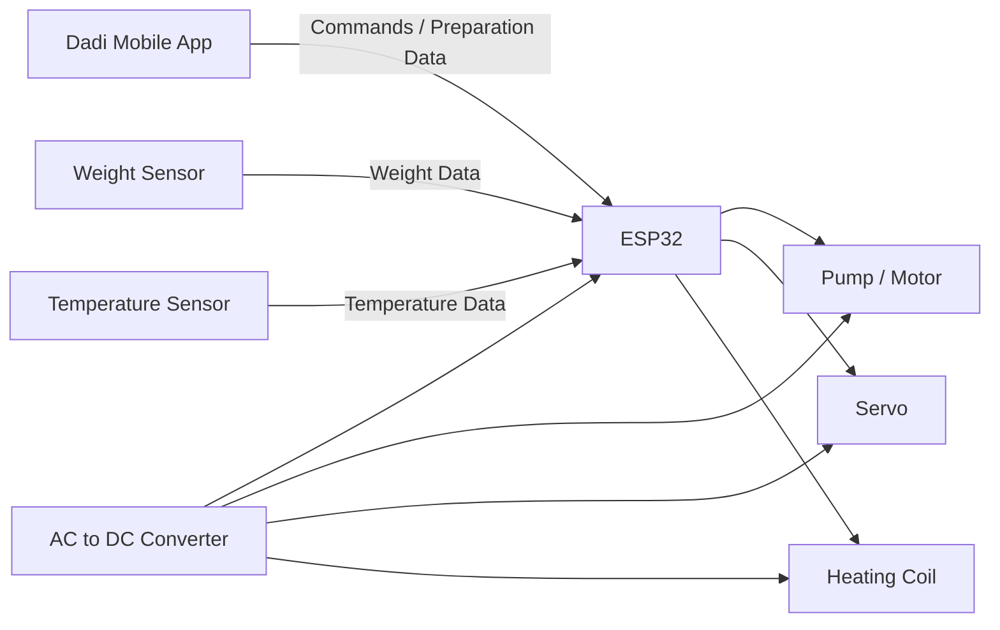
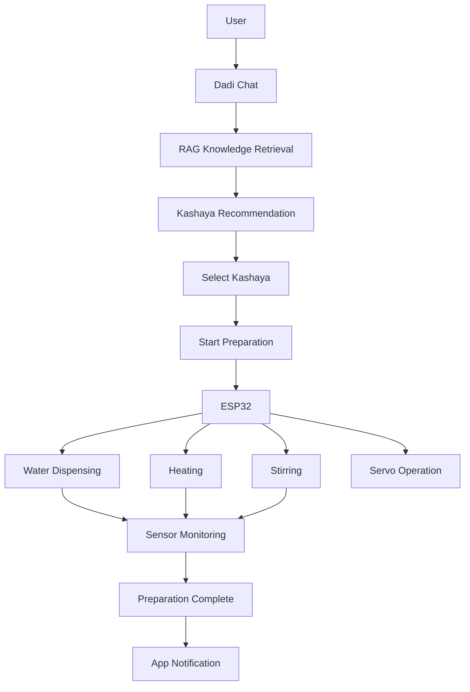

# Dadi - Your Health Partner & Smart Kashaya Maker

## 1. Project Overview

This project consists of two main parts:
1. **Dadi Mobile App** — the user-facing application where users interact with Dadi through a chat interface, search for Kashayas, receive recommendations, and start the preparation process.
2. **Smart Kashaya Maker (Planned Hardware)** — an ESP32-controlled hardware system designed to automatically prepare the selected Kashaya.

**The overall workflow is:**
**User → Dadi App → Kashaya Selection → Start Preparation → ESP32 → Kashaya Maker → Preparation Status → App**

*(Note: Currently, the Dadi app simulates the hardware communication and preparation process for demonstration purposes. The physical hardware integration is a planned feature.)*

---

## 2. Dadi App

The mobile application is built using **React Native with Expo**. 

The app provides:
- **Dadi conversational interface:** Allows the user to communicate naturally with Dadi instead of navigating through complicated menus.
- **Kashaya recommendations:** Symptom/requirement-based Kashaya suggestions.
- **Direct Kashaya search:** Accessible through the chat interface.
- **Kashaya details:** Preparation time and serving information.
- **Start Preparation functionality:** To trigger the Kashaya maker.
- **Hardware/device connection:** (Currently simulated)
- **Live preparation status:** (Currently simulated) Heating status, stirring status, target temperature.
- **Preparation completion notification:** Alerts the user when the Kashaya is ready.

### RAG-based Chat Architecture

The chat system utilizes a Retrieval-Augmented Generation (RAG) pipeline:

**User Query → Query Understanding → Relevant Kashaya Knowledge Retrieval → Context → AI Response**

The system retrieves relevant information from the Kashaya knowledge base and uses that retrieved context to generate a relevant response. Dadi provides Kashaya-related guidance and recommendations based on the available knowledge base, rather than acting as a fully autonomous medical diagnosis system.

---

## 3. Hardware Architecture

The Smart Kashaya Maker hardware is intentionally minimal and uses an **ESP32** as the main controller.

The hardware consists of:
- **ESP32** (Central Controller)
- **Weight sensor**
- **Temperature sensor**
- **Pump/motor**
- **Servo motor**
- **Heating coil**
- **AC-to-DC power converter**

### ESP32

The ESP32 acts as the **central controller** of the Kashaya Maker. It receives commands from the mobile application and controls/monitors the connected hardware components.

The ESP32 is responsible for coordinating:
- Water dispensing through the pump
- Heating through the heating coil
- Stirring through the motor
- Servo-controlled mechanical operation
- Temperature monitoring
- Weight monitoring
- Start/stop control
- Preparation-state monitoring

---

## 4. Hardware Working

The basic operating sequence of the planned hardware is as follows:

### Step 1 — User selects Kashaya
The user selects a Kashaya from the Dadi app and presses **Start Preparation**.

### Step 2 — App sends command
The application sends the selected preparation information/command to the ESP32.

### Step 3 — ESP32 initializes preparation
The ESP32 checks the required preparation parameters and begins the process.

### Step 4 — Water dispensing
The ESP32 activates the pump/motor to add the required amount of water. The weight sensor is used to monitor the quantity/weight during this process.

### Step 5 — Heating
The ESP32 controls the heating coil according to the required preparation conditions. The temperature sensor continuously monitors the temperature.

### Step 6 — Stirring
The motor operates the stirring mechanism to continuously or appropriately stir the Kashaya during preparation.

### Step 7 — Servo operation
The servo is used for the required mechanical actuation in the preparation mechanism (e.g., dispensing the Kashaya mix or operating valves).

### Step 8 — Monitoring
The ESP32 continuously monitors the relevant sensor values, particularly:
- Temperature
- Weight
- Preparation state

### Step 9 — App control
The mobile application can communicate preparation commands such as:
- Start
- Stop
- Preparation status
- Required preparation parameters

The ESP32 executes these commands and controls the hardware accordingly.

### Step 10 — Completion
Once the preparation process reaches its required conditions, the ESP32 reports the completion state back to the application. The application then informs the user that the Kashaya is ready.

---

## 5. Hardware Block Diagram



---

## 6. Complete System Flow



---

## 7. Communication Architecture

**App → Communication Layer → ESP32 → Hardware**

*Implementation Status:*
Based on the current source code, the communication layer between the React Native App and the ESP32 is **fully simulated**. The application uses local simulated timers and mock sensor values (like mock temperatures and progress ratios) to visualize the preparation state in the app (`PreparationScreen`).

When the hardware integration is implemented, this architecture will be updated to document the actual protocol (e.g., HTTP, BLE, or MQTT) used to send preparation commands and receive status updates from the ESP32.

---

## 8. Power System

An **AC-to-DC converter** is used to provide the required DC power for the electronics and controlled components (ESP32, motors, sensors).

---

## 9. Repository Structure

```text
Dadi/
├── app.json            # Expo configuration
├── App.tsx             # Application entry point
├── assets/             # Images, fonts, and static assets
├── components/         # Reusable React Native components (UI)
├── constants/          # Application constants (Colors, layout sizes)
├── data/               # Mock data (Kashayas list, chat data)
├── navigation/         # React Navigation setup
├── screens/            # Application screens (Home, Chat, Preparation, etc.)
├── utils/              # Helper functions and utilities
└── README.md           # Project documentation
```
